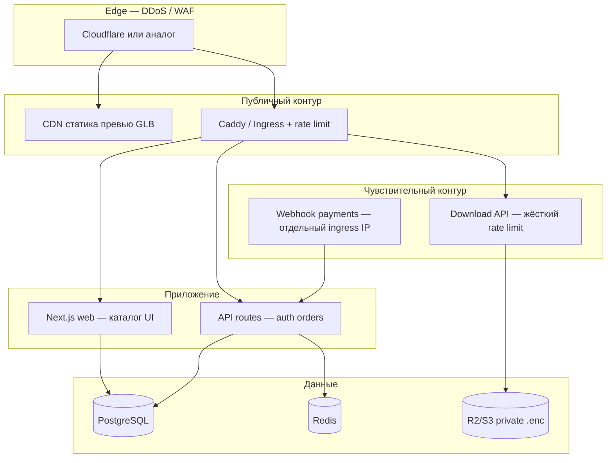

# Инфраструктура: разделение сервисов, DDoS, Docker / Kubernetes

Цель: **положить каталог** сложнее, **скачивание моделей** — отдельный контур с лимитами, **оплата** — изолированный webhook, **БД и файлы** — не в одном процессе с публичным edge.

---

## Схема (целевая)



---

## Разделение: зачем что

| Сервис | Роль | Если упадёт / атакуют |
|--------|------|------------------------|
| **CDN + WAF** | Кэш превью, фильтр L3–L7, bot fight | Основной удар принимает edge; origin жив |
| **Reverse proxy** | TLS, лимиты RPS, таймауты, только HTTP | Защита Node от slowloris |
| **Web (Next)** | HTML, каталог, превью-страницы | Можно отдать статику из CDN при падении API |
| **API** | Auth, заказы, checkout session | Без API нельзя купить/скачать — но каталог можно кэшировать |
| **Webhook** | Только `POST` от LiqPay/WayForPay | Отдельный hostname `pay-webhook.домен`, firewall по IP шлюза |
| **Download** | Тяжёлые ответы | Отдельный subdomain `files.домен`, низкий RPS, очередь |
| **PostgreSQL** | Пользователи, заказы, grants | Нет прямого доступа из интернета |
| **Redis** | Rate limit, сессии (опционально) | In-memory fallback только на 1 инстансе |
| **Object storage** | `.enc` модели | Нет SSH на сервер с файлами |

Сейчас код — **монолит Next.js**; разделение начинается с **Docker Compose** (proxy + app + redis), дальше — **Kubernetes** (несколько Deployment).

---

## DDoS: уровни защиты

### 1. Edge (обязательно на проде)

- Cloudflare / Fastly / хостинг с anti-DDoS.
- **Under attack mode** при пике.
- Кэш: `public/previews/*.glb`, картинки, статика Next.
- **Не проксировать** `/api/download/*` через агрессивный кэш.

### 2. Reverse proxy (Caddy / Nginx / Ingress)

- `rate_limit` на `/api/auth/*`, `/api/download/*`.
- Таймауты: download max 60s, обычные API 15s.
- Ограничение размера body (webhook / register).
- Только TLS 1.2+.

### 3. Приложение

- Redis rate limit (`REDIS_URL`) — общий счётчик на все реплики.
- Одноразовые download grants.
- Health `/api/health` для orchestrator (не кэшировать).

### 4. Архитектурные приёмы

| Приём | Эффект |
|-------|--------|
| Каталог без БД на edge | ISR / static где возможно |
| Очередь на выдачу файла | Worker читает R2, не блокирует web |
| Autoscaling web replicas | HPA по CPU/latency |
| Отдельный пул для download | Атака на скачивание не жрёт checkout |
| CAPTCHA на login при 429 | После N неудачных входов |

**Реальность:** объёмный L3/L4 DDoS без Cloudflare/VPS-провайдера не победить одним Docker на VPS. Edge + провайдер — must have.

---

## Docker Compose (старт)

В репозитории: `docker-compose.yml` + `docker/Caddyfile`.

```bash
docker compose up --build
```

- **caddy** — порты 80/443, rate limit, прокси на app.
- **app** — Next.js production image.
- **redis** — rate limit между рестартами.

Данные: volume `storage/private`, SQLite или позже Postgres (см. ниже).

---

## Kubernetes (когда вырастете)

| Deployment | replicas | notes |
|------------|----------|-------|
| `figurki-web` | 2–10 HPA | каталог, UI |
| `figurki-api` | 2–8 | те же image, env `SERVICE_ROLE=api` если разделите |
| `figurki-webhook` | 2 | только маршрут webhook |
| `redis` | 1 или managed | ElastiCache / Upstash |
| `postgres` | managed | RDS / Supabase / Neon |

**NetworkPolicy:**

- `postgres`: ingress только от `figurki-web` / `figurki-api`.
- `figurki-webhook`: ingress только от IP LiqPay/WayForPay + internal.
- egress app → postgres, redis, R2 API only.

**Secrets:** Kubernetes Secrets / External Secrets → `SESSION_SECRET`, `MODEL_ENCRYPTION_KEY`, `PAYMENT_WEBHOOK_SECRET`.

Пример манифестов: `k8s/README.md` (шаблон).

---

## Миграция с SQLite на PostgreSQL (прод)

1. `provider = "postgresql"` в `schema.prisma`.
2. Managed Postgres, бэкапы, encryption at rest от провайдера.
3. SQLite только локально для разработки (отдельный `.env.local`).

---

## Мониторинг

- Uptime: health check.
- Alerts: 5xx rate, latency p95, failed logins, download 403 spike.
- Audit log: `PAID`, download grant used (таблица / Loki).

---

## Чеклист перед боем

- [ ] Cloudflare (или аналог) перед origin
- [ ] HTTPS, HSTS
- [ ] Redis для rate limit
- [ ] Postgres, не SQLite
- [ ] Модели в R2 private, не на диске VPS
- [ ] Webhook на отдельном hostname + IP allowlist
- [ ] Secrets не в git
- [ ] 2FA на админку и хостинг
