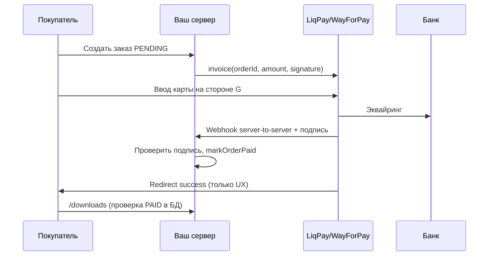

# Безопасность платежей и персональных данных

## Главное правило PCI

**Вы не храните данные карт.** Номер карты, CVV, срок — только на стороне **LiqPay / WayForPay / банка** (PCI DSS у них).

Ваш сайт — **не мерчант-хранилище карт**, а магазин с редиректом / iframe / hosted checkout шлюза.

---

## Что можно хранить в БД

| Поле | OK | Запрещено |
|------|-----|-----------|
| `orderId` (внутренний) | ✅ | |
| `status` PENDING/PAID | ✅ | |
| `priceUah`, `productId` | ✅ | |
| `paymentProvider` | ✅ | |
| `paymentExternalId` (id транзакции шлюза) | ✅ | |
| `paidAt` | ✅ | |
| Email пользователя | ✅ (закон о персданных / GDPR — политика) | |
| PAN, CVV, track data | ❌ | **Никогда** |
| Полный ответ webhook с картой | ❌ | Логировать только id + status |

---

## Поток оплаты (безопасный)

1. **Redirect «успех»** не ставит `PAID` — только webhook (или signed callback API шлюза).
2. **Подпись** каждого webhook — по документации LiqPay/WayForPay (не ваш общий `PAYMENT_WEBHOOK_SECRET` вместо их схемы — использовать **их** ключ + при необходимости дополнительный internal HMAC).
3. **Идемпотентность:** один `paymentExternalId` → один `PAID` (`unique` в БД).
4. **Сумма:** сверять amount из webhook с `order.items.priceUah` (защита от подмены).

---

## Webhook endpoint

- URL: `https://pay-webhook.ваш-домен/api/webhooks/payment` (или маршрут шлюза).
- **TLS 1.2+**, только POST.
- IP allowlist провайдера на firewall / Ingress.
- Тело — сырой text для проверки подписи (как в коде).
- Логировать: timestamp, orderId, externalId, result — **без** PAN.

Тестовая кнопка `simulate-pay` — **выключена на production** (`isTestPaymentAllowed`).

---

## Персональные данные (email, адрес доставки)

| Мера | Действие |
|------|----------|
| Минимизация | Собирать только нужное для заказа |
| Шифрование в пути | HTTPS |
| Шифрование БД | at-rest у managed Postgres |
| Доступ | Админ по роли, audit |
| Удаление | По запросу пользователя (процедура) |
| Пароли | bcrypt, не plaintext |

Адрес Nova Poshta (позже) — в БД, не в логах, не в клиентской аналитике.

---

## Угрозы оплаты

| Атака | Защита |
|-------|--------|
| Подделка webhook | Криптоподпись шлюза + IP allowlist |
| Повтор webhook (replay) | `paymentExternalId` unique, idempotent markOrderPaid |
| Оплата 1 грн вместо 299 | Сверка суммы в webhook |
| Чужой orderId | order привязан к userId при создании |
| XSS на checkout | CSP, httpOnly session |
| MITM | HSTS, нет mixed content |
| Утечка ключей API | Secrets manager, ротация |

---

## ФОП / ПРРО (Украина)

- Фискальный чек через Checkbox/Вчасно — **после** подтверждённой оплаты.
- Данные чека — у провайдера ПРРО; у себя хранить ссылку/номер чека при необходимости.

---

## Интеграция LiqPay (напоминание)

- Private key только на сервере.
- `data` + `signature` для checkout.
- Callback URL — webhook, не страница пользователя.
- Sandbox и production ключи раздельно.

Детали — в официальной документации LiqPay; при внедрении добавить `lib/payments/liqpay-verify.ts` с их алгоритмом SHA1/base64.
